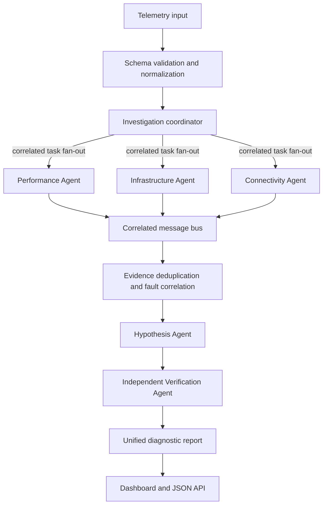

# NetCoop AI Architecture

## Investigation flow

## Agent responsibilities

| Agent | Responsibility | Main evidence |
|---|---|---|
| Performance | Latency, loss, jitter, bandwidth, throughput | Performance metrics and thresholds |
| Infrastructure | Device/interface state, CPU, memory, utilization, errors, queue drops | Infrastructure health and counters |
| Connectivity | RSSI, Wi-Fi retransmissions, DNS/DHCP failures, reachability context, neighbors | Wireless/service/connectivity signals |
| Fault correlation | Deduplicate and correlate anomalies across metric domains | Structured evidence IDs and severity |
| Hypothesis | Generate evidence-grounded candidate explanations | Evidence catalogue |
| Verification | Challenge candidates and identify missing/contradicting evidence | Hypotheses and evidence catalogue |
| Coordinator | Concurrently fan out, correlate, track tasks, aggregate results | Protocol timeline and partial results |

## Evidence processing

1. Normalize accepted aliases and units to canonical metric keys.
2. Diagnostic agents emit both readable findings and structured evidence.
3. Evidence IDs are stable within an incident/device/metric; repeated copies are deduplicated.
4. The correlation agent reports cross-domain anomalies without asserting causation.
5. The hypothesis agent creates candidates only where threshold-breaching evidence exists.
6. The verification agent uses a conservative cross-domain corroboration rule. One telemetry domain alone normally remains inconclusive.
7. The coordinator reports `no_fault_detected` only for a sufficiently populated clean snapshot; otherwise it abstains with `insufficient_evidence`.

## Orchestration and failures

The coordinator fans out one correlated task to each registered diagnostic specialist using `Promise.all`. Each request is tracked by the task manager with a bounded retry policy. The coordinator retains successful findings if another specialist fails and records the failure in limitations/recommendations. The specialist adapters are synchronous local analyzers today; the fan-out contract is ready for asynchronous or remote adapters, but this release does not claim CPU-parallel worker execution. The default diagnostic pipeline is deterministic and does not depend on a remote LLM service.

## Topology boundary

Only explicitly supplied neighbor relationships are represented. The prototype does not infer multi-hop paths, routing state, or affected downstream devices from a single record.
